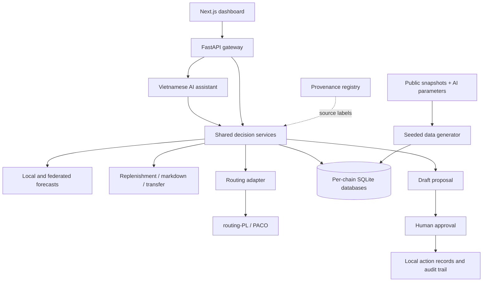

<div align="center">
  
  <h1>FreshMesh</h1>
  <p><strong>Fresh decisions. Connected stores.</strong></p>
  <p>Forecast demand, plan fresh-goods replenishment, and coordinate delivery across independent mini-mart chains.</p>
  <p>
    <a href="LICENSE"></a>
    
    
    
    <a href="CONTRIBUTING.md"></a>
  </p>
  <p><a href="#quick-start">Quick start</a> · <a href="#how-it-works">Architecture</a> · <a href="#research-and-limitations">Research</a> · <a href="CONTRIBUTING.md">Contribute</a> · <a href="SECURITY.md">Security</a></p>
</div>

---

## Why FreshMesh?

Fresh groceries create a daily balancing act: order too much and stock expires; order too little and customers leave empty-handed. FreshMesh brings forecasting, inventory decisions, surplus handling, and delivery planning into one workflow for store managers and chain owners.

Built around a Ho Chi Minh City demo, it combines a **Vietnamese-language interface and AI assistant** with explicit data provenance and human approval. This repository contains the working prototype, reproducible data pipeline, and research reports. The banner above is an AI-generated concept illustration, not a screenshot.

> **Project status:** research prototype, version 0.1.0. Demo sales, inventory, and orders are generated from AI-proposed parameters and public contextual data. They are not real store transactions. Approved actions are recorded locally; external purchasing and dispatch systems are not connected.

## What you can explore

| Capability | What it does |
| --- | --- |
| **Demand forecasting** | Local quantile forecasts with P10/P50/P90 intervals and conformal calibration. |
| **Federated learning** | Experiments across independent chains, with comparisons against local models and optional differential-privacy experiments. |
| **Replenishment** | Inventory recommendations accounting for shelf life, demand uncertainty, and operational constraints. |
| **Surplus decisions** | Compare scheduled markdowns with inter-store transfers using consistent cash-value assumptions. |
| **Delivery planning** | PACO vehicle routing through the external `routing-PL` solver, including pickup points and time windows. |
| **Vietnamese AI assistant** | Claude tool calling, source-labelled answers, numerical checks, and draft proposals. Requires an API key. |
| **Human approval** | Review, edit, approve, or reject drafts; inspect the decision audit trail. |
| **Traceable evidence** | Dataset identifiers, assumptions, AI parameter prompts, and experiment protocols accompany results. |

## Quick start

### 1. Install prerequisites

Use Python **3.12+**, [uv](https://docs.astral.sh/uv/), Node.js **22.13+** with npm, Git, and Docker with Compose v2. The commands below use Bash (Linux, macOS, or WSL).

```bash
git clone --recurse-submodules https://github.com/ttadev24/FreshMesh.git
cd FreshMesh
uv sync --locked
(cd web && npm ci)
```

For an existing clone, run `git submodule update --init --recursive`. The solver is a separate repository pinned by the submodule.

### 2. Start the routing solver

```bash
docker compose up -d --build solver
curl --fail http://localhost:8000/health
```

The default solver port is **8000**. If it is occupied, copy `.env.example` to `.env` and change **both** `FRESHMESH_SOLVER_PORT` and `FRESHMESH_SOLVER_URL` before starting Compose. The solver must be ready before routing requests succeed.

### 3. Generate demo data and train local models

```bash
scripts/bootstrap.sh --skip-fl
```

This builds the three chain databases and local models using committed snapshots and seed 42. It does not require an LLM key or new public-data downloads. Run it in a fresh checkout or with a separate `FRESHMESH_DATA_DIR`: it regenerates demo data.

For the full federated-learning experiments and models, run `scripts/bootstrap.sh` without `--skip-fl`. This also writes experiment outputs under `docs/experiments/`. When FL artifacts are absent, `/api/network/fl` returns `503 fl_not_ready`.

### 4. Start the API and web app

In one terminal, from the repository root:

```bash
scripts/dev_api.sh
```

In another terminal:

```bash
cd web
npm run dev
```

Open **[http://localhost:3100](http://localhost:3100)** and sign in with **`owner_a` / `demo123`**.

The API listens on `127.0.0.1:8100`. The development script permits a local development signing key when `FRESHMESH_SECRET` is absent. For a persistent installation, set a random secret of at least 32 characters in the root `.env.local`; see [configuration](docs/configuration.md).

| Role | Demo usernames | Password | Scope |
| --- | --- | --- | --- |
| Chain owner | `owner_a`, `owner_b`, `owner_c` | `demo123` | All stores within the respective chain |
| Store manager | `manager_a1`, `manager_b1`, `manager_c1` | `demo123` | Store CH1 within the respective chain |

### 5. Enable optional services

- **AI chat:** copy `.env.local.example` to the root `.env.local`, add `ANTHROPIC_API_KEY`, and restart the API. Without it, chat returns `503 llm_unavailable`; dashboards and decision tools remain available.
- **Map tiles:** copy `web/.env.local.example` to `web/.env.local`, set `NEXT_PUBLIC_VIETMAP_API_KEY`, and restart the web app. Rebuild production assets after changing this key.
- **Road geometry:** set the separate server-side `FRESHMESH_VIETMAP_ROUTE_KEY` in the root `.env.local`. Without it, maps use labelled straight-line segments.
- **Jev guardrail:** optional OpenRouter integration; see [configuration](docs/configuration.md).

These providers may require paid accounts. The software license does not include access to their services.

## Try a workflow

1. Sign in as a chain owner and inspect forecasts and data sources.
2. Create a replenishment proposal, or compare markdowns and stock transfers.
3. Review quantities, assumptions, and expected outcomes in the draft.
4. Approve or reject the draft and inspect the audit record.
5. Generate a delivery plan with the running solver.

You can also use the Python entry points:

```bash
# Replenishment workflow through the same service layer as the API
uv run python -m decision.cli flow1 --chain CHAIN_A --store A-CH1 --items rau,thit

# Solve a synthetic example delivery batch
uv run python -m routing.cli routing/examples/batch_q7.json

# Inspect dataset provenance and recorded AI parameter prompts
uv run python -m provenance show
uv run python -m provenance prompts
```

The assistant proposes drafts. Approval through `POST /api/drafts/{id}/approve` is the execution boundary for local records, including purchases, markdown schedules, transfers, and route dispatch markers.

## How it works



| Directory | Responsibility |
| --- | --- |
| `web/` | Next.js, React, TypeScript, ECharts, and VietMap UI |
| `api/` | Authentication, authorization, service endpoints, drafts, and audit access |
| `agent/` | Claude integration, tools, SQL restrictions, verification, and evaluations |
| `forecasting/` | Quantile models, baselines, calibration, and federated experiments |
| `decision/` | Inventory, markdown, transfer, and trade-off calculations |
| `routing/` | Solver adapter, validation, caching, CLI, and `routing-PL` submodule |
| `data_sim/`, `data_real/` | Demo generation, public snapshots, and AI-generated parameters |
| `data_frn/` | Separate validation pipeline for FreshRetailNet-50K |
| `provenance/`, `data/provenance/` | Dataset registry, manifests, prompts, and responses |
| `simulation/` | Inventory simulations and routing benchmarks |
| `tests/`, `web/e2e/` | Python tests and Playwright scenarios |
| `docs/` | Methods, configuration, protocols, and research results |

## Research and limitations

The repository reports unsuccessful outcomes as well as improvements. These are results from the committed experiments, not guarantees for live stores.

| Experiment | Recorded finding | Evidence |
| --- | --- | --- |
| Federated forecasting | FL did not outperform local forecasting overall: WAPE 0.4432 vs 0.4408. The deployed FL configuration does not enable DP. | [FL results](docs/experiments/fl-results.md) |
| 30-day inventory simulation | The original policy missed waste targets for all three chains. The revised policy met them for A and C, but not B; it was adjusted after seeing results. | [Simulation results](docs/experiments/sim30-results.md) |
| Delivery routing | PACO used 320.8 km vs 985.7 km for one-trip-per-order, but still had 29 projected late stops. | [Routing benchmark](docs/experiments/routing-benchmark.md) |
| Assistant evaluation | The recorded 32-question run reached 90.6% tool selection accuracy; later prompt changes were not re-evaluated in that report. | [Agent evaluation](docs/experiments/agent-eval-haiku55.md) |
| Real retail data | FreshRetailNet-50K has a separate audit and pre-registered protocol. It represents Chinese retail demand, not Vietnamese mini-mart transactions. | [Audit](docs/experiments/frn-data-audit.md) · [Protocol](docs/experiments/frn-protocol.md) |

<details>
<summary><strong>View the recorded routing benchmark</strong></summary>


The chart compares the recorded solver runs. See the benchmark report for instance sizes, feasibility, late stops, and baseline definitions.

</details>

Additional constraints:

- Routing uses a **1.3 distance multiplier**; the OSRM car-profile check found a median of **1.58**. Distances and arrival times may be underestimated. VietMap geometry only changes the rendered road path. [Details](docs/data-real-detour.md).
- A cold solver request can take seconds or longer. Successful routes are cached by batch hash with `cached` and `solved_at` metadata; solver failures are surfaced as errors.
- Public locations and weather are combined with synthetic business activity. Every result must preserve its provenance labels. [Data provenance](docs/data-provenance.md).
- SQL guards and numerical checks have limits: computed expressions over real columns can still produce misleading values. [Operational limitations](docs/limitations.md).
- Dependency constraints and deployment considerations are documented in [Security](SECURITY.md). This prototype has no production support guarantee.

## Development

```bash
uv run pytest                         # Default suite excludes integration tests
uv run ruff check
(cd web && npm run lint && npm run typecheck)

# Requires a running solver
uv run pytest -m integration

# Requires bootstrapped demo data and a solver; Playwright can start API/web
(cd web && npx playwright install chromium && npm run test:e2e)
```

Some chat scenarios require provider credentials and incur API usage. Read the [contribution guide](CONTRIBUTING.md) before running external-service evaluations or changing experiment outputs.

## Documentation

| Start here | Further reading |
| --- | --- |
| [Configuration and troubleshooting](docs/configuration.md) | Environment files, ports, optional integrations, production commands |
| [Decision methods](docs/decision-methods.md) | Inventory and surplus objectives and assumptions |
| [API contract notes](docs/api-contract-notes.md) | Endpoint behavior and integration details |
| [Data provenance](docs/data-provenance.md) | Sources, AI prompts, and dataset rights |
| [Data assumptions](docs/data-assumptions.md) | Simulation and economic assumptions |
| [Operational limitations](docs/limitations.md) | Known constraints and evaluation caveats |
| [Original design](docs/superpowers/specs/2026-10-12-freshmesh-design.md) | Design rationale and intended workflows |
| [Third-party notices](THIRD_PARTY_NOTICES.md) | Upstream projects, data licenses, and template sources |

The README and community guides are in English. Some existing technical reports and the application are in Vietnamese; translations are welcome.

## Community

Bug reports, documentation fixes, translations, and reproducible research improvements are welcome.

- Read [Contributing](CONTRIBUTING.md) for setup, checks, and the pull-request process.
- Follow the [Code of Conduct](CODE_OF_CONDUCT.md), adapted from Contributor Covenant 2.1.
- Use [GitHub Issues](https://github.com/ttadev24/FreshMesh/issues) for bugs and feature proposals.
- Follow [Security](SECURITY.md) for vulnerability reports; avoid publishing exploit details in ordinary issues.
- See [Support](SUPPORT.md) for usage questions.

## License and acknowledgements

FreshMesh's original code is licensed under **GNU GPL v3.0 only** (`GPL-3.0-only`). See [LICENSE](LICENSE), copied from [GitHub's Choose a License template](https://github.com/github/choosealicense.com/blob/gh-pages/_licenses/gpl-3.0.txt). You may use, modify, and distribute it, including commercially, subject to the GPL's terms.

Third-party code, datasets, and services retain their own terms. The root license does not relicense `routing-PL`, OpenStreetMap data, or other upstream materials. See [Third-party notices](THIRD_PARTY_NOTICES.md).

Thanks to [routing-PL](https://github.com/chauanphu/routing-PL), OpenStreetMap contributors, Open-Meteo, and the FreshRetailNet-50K authors, alongside the open-source libraries that make this project possible.
