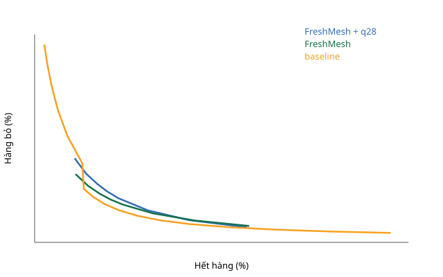

<!-- GENERATED by `python -m data_frn inventory-report`; do not edit by hand -->
# FreshRetailNet — sửa đổi frn-v1.1: cùng quy tắc đặt hàng, bộ dự báo phân vị 28 ngày

**Thăm dò, viết sau khi đã thấy kết quả frn-v1** ([frn-protocol-v1.1.md](frn-protocol-v1.1.md)). Không đổi kết luận I1 của frn-v1 ([frn-inventory.md](frn-inventory.md)).

## Hạn dùng 2 ngày — chính / primary

Giao thức `frn-v1.1` (sha256 `74b0267dff9f…`), 688 cửa hàng.

FreshMesh + q28 − baseline (âm là FreshMesh tốt hơn):

| Hết hàng | Chênh lệch hàng bỏ (điểm %) | 95% CI | Không xác định |
|---|---|---|---|
| 5% | — | [-2,32; -0,92] | 58,3% |
| 10% | 2,48 | [2,14; 2,83] | 0,0% |
| 15% | 1,44 | [1,24; 1,64] | 0,0% |

FreshMesh + q28 − FreshMesh MLP (không có tiêu chí đạt/không đạt):

| Hết hàng | Chênh lệch hàng bỏ (điểm %) | 95% CI | Không xác định |
|---|---|---|---|
| 5% | — | [2,26; 3,46] | 83,7% |
| 10% | 1,06 | [0,63; 1,48] | 0,0% |
| 15% | 0,33 | [0,01; 0,58] | 0,0% |

Hết hàng thấp nhất mỗi họ chính sách đạt được: FreshMesh + q28 5,04%; FreshMesh 5,15%; baseline 1,22%. Ô '—' là mức nằm ngoài đường biên của một họ; quy tắc tính ô đó là không đạt. 'Không xác định' là tỉ lệ lần lấy mẫu lại rơi vào trường hợp này.

**I1′ KHÔNG ĐẠT / FAIL** (thăm dò, sau khi xem kết quả).

## Hạn dùng 1 ngày — độ nhạy / sensitivity

Giao thức `frn-v1.1` (sha256 `74b0267dff9f…`), 688 cửa hàng.

FreshMesh + q28 − baseline (âm là FreshMesh tốt hơn):

| Hết hàng | Chênh lệch hàng bỏ (điểm %) | 95% CI | Không xác định |
|---|---|---|---|
| 5% | — | [—; —] | 100,0% |
| 10% | 1,65 | [1,19; 2,13] | 0,0% |
| 15% | 1,91 | [1,59; 2,24] | 0,0% |

FreshMesh + q28 − FreshMesh MLP (không có tiêu chí đạt/không đạt):

| Hết hàng | Chênh lệch hàng bỏ (điểm %) | 95% CI | Không xác định |
|---|---|---|---|
| 5% | — | [0,83; 2,54] | 85,1% |
| 10% | 0,62 | [-0,15; 1,51] | 0,0% |
| 15% | -0,02 | [-0,74; 0,64] | 0,0% |

Hết hàng thấp nhất mỗi họ chính sách đạt được: FreshMesh + q28 5,04%; FreshMesh 5,17%; baseline 6,22%. Ô '—' là mức nằm ngoài đường biên của một họ; quy tắc tính ô đó là không đạt. 'Không xác định' là tỉ lệ lần lấy mẫu lại rơi vào trường hợp này.

## Hạn dùng 3 ngày — độ nhạy / sensitivity

Giao thức `frn-v1.1` (sha256 `74b0267dff9f…`), 688 cửa hàng.

FreshMesh + q28 − baseline (âm là FreshMesh tốt hơn):

| Hết hàng | Chênh lệch hàng bỏ (điểm %) | 95% CI | Không xác định |
|---|---|---|---|
| 5% | — | [-1,81; 0,02] | 57,4% |
| 10% | 1,10 | [0,92; 1,30] | 0,0% |
| 15% | 0,55 | [0,46; 0,66] | 0,0% |

FreshMesh + q28 − FreshMesh MLP (không có tiêu chí đạt/không đạt):

| Hết hàng | Chênh lệch hàng bỏ (điểm %) | 95% CI | Không xác định |
|---|---|---|---|
| 5% | — | [0,77; 1,39] | 82,2% |
| 10% | 0,23 | [0,05; 0,42] | 0,0% |
| 15% | -0,01 | [-0,14; 0,10] | 0,0% |

Hết hàng thấp nhất mỗi họ chính sách đạt được: FreshMesh + q28 5,04%; FreshMesh 5,12%; baseline 0,48%. Ô '—' là mức nằm ngoài đường biên của một họ; quy tắc tính ô đó là không đạt. 'Không xác định' là tỉ lệ lần lấy mẫu lại rơi vào trường hợp này.
