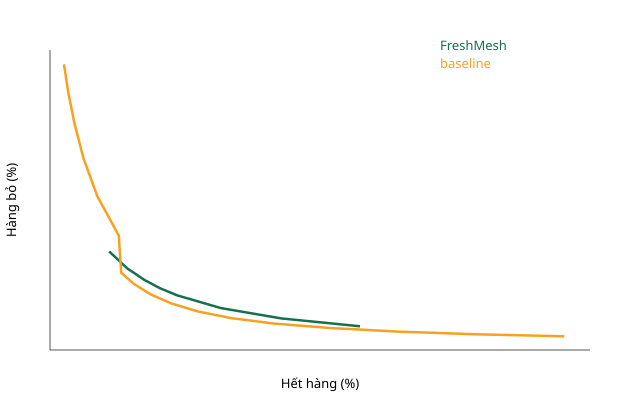

<!-- GENERATED by `python -m data_frn inventory-report`; do not edit by hand -->
# FreshRetailNet — chính sách nhập hàng / inventory policies (frn-v1 §3)

## Hạn dùng 2 ngày — chính / primary

Giao thức `frn-v1` (sha256 `379e4a299d5b…`), 688 cửa hàng.

| Hết hàng | Hàng bỏ FreshMesh − baseline (điểm %) | 95% CI | Không xác định |
|---|---|---|---|
| 5% | — | [-5,47; -3,86] | 66,5% |
| 10% | 1,42 | [1,06; 1,76] | 0,0% |
| 15% | 1,10 | [0,86; 1,44] | 0,0% |

Hết hàng thấp nhất mỗi họ chính sách đạt được: FreshMesh 5,15%; baseline 1,22%. Ô '—' là mức nằm ngoài đường biên của một họ; quy tắc tính ô đó là không đạt. 'Không xác định' là tỉ lệ lần lấy mẫu lại rơi vào trường hợp này.

**I1 KHÔNG ĐẠT / FAIL**

## Hạn dùng 1 ngày — độ nhạy / sensitivity

Giao thức `frn-v1` (sha256 `379e4a299d5b…`), 688 cửa hàng.

| Hết hàng | Hàng bỏ FreshMesh − baseline (điểm %) | 95% CI | Không xác định |
|---|---|---|---|
| 5% | — | [—; —] | 100,0% |
| 10% | 1,03 | [0,26; 1,74] | 0,0% |
| 15% | 1,93 | [1,20; 2,74] | 0,0% |

Hết hàng thấp nhất mỗi họ chính sách đạt được: FreshMesh 5,17%; baseline 6,22%. Ô '—' là mức nằm ngoài đường biên của một họ; quy tắc tính ô đó là không đạt. 'Không xác định' là tỉ lệ lần lấy mẫu lại rơi vào trường hợp này.

## Hạn dùng 3 ngày — độ nhạy / sensitivity

Giao thức `frn-v1` (sha256 `379e4a299d5b…`), 688 cửa hàng.

| Hết hàng | Hàng bỏ FreshMesh − baseline (điểm %) | 95% CI | Không xác định |
|---|---|---|---|
| 5% | — | [-3,27; -1,11] | 63,9% |
| 10% | 0,87 | [0,69; 1,05] | 0,0% |
| 15% | 0,56 | [0,45; 0,71] | 0,0% |

Hết hàng thấp nhất mỗi họ chính sách đạt được: FreshMesh 5,12%; baseline 0,48%. Ô '—' là mức nằm ngoài đường biên của một họ; quy tắc tính ô đó là không đạt. 'Không xác định' là tỉ lệ lần lấy mẫu lại rơi vào trường hợp này.
