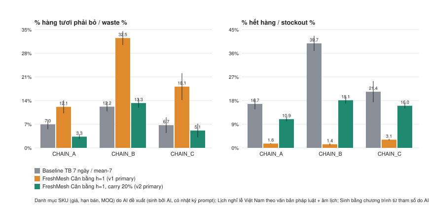

<!-- BEGIN GENERATED -->
# Sim30 — kết quả mô phỏng 30 ngày / 30-day inventory simulation results

Nguồn dữ liệu: **Danh mục SKU (giá, hạn bán, MOQ) do AI đề xuất (sinh bởi AI, có nhật ký prompt); Lịch nghỉ lễ Việt Nam theo văn bản pháp luật + âm lịch; Sinh bằng chương trình từ tham số do AI (Claude Haiku 5.5) tạo; không phải giao dịch thật; © OpenStreetMap contributors (ODbL); Vị trí thật từ OpenStreetMap (ODbL), gán chuỗi bằng chương trình; Lượng mưa ngày TP.HCM — Open-Meteo Historical Weather API (CC BY 4.0); Dự báo mưa TP.HCM — Open-Meteo Forecast API (CC BY 4.0)**. Giao thức đăng ký trước: [sim30-protocol.md](sim30-protocol.md) (`sim30-v1`, revision `sim30-v2`). Seeds 1001, 1002, 1003, 1004, 1005; mean [95% t-CI] over seeds; % pooled over stores × 14 fresh SKUs × 30 days.

## Kết luận theo tiêu chí §1.4 #3 / Verdict

| Chuỗi / chain | v1: Cân bằng h=1 (pre-registered) | v2: carry 20% (revision) |
|---|---|---|
| CHAIN_A | **KHÔNG ĐẠT / FAIL** — Δbỏ 5.19 [4.42; 5.95] pp; Δhết hàng -15.09 [-17.10; -13.09] pp | **ĐẠT / PASS** — Δbỏ -3.65 [-4.57; -2.73] pp; Δhết hàng -5.79 [-7.31; -4.28] pp |
| CHAIN_B | **KHÔNG ĐẠT / FAIL** — Δbỏ 20.30 [19.32; 21.28] pp; Δhết hàng -38.38 [-41.28; -35.49] pp | **KHÔNG ĐẠT / FAIL** — Δbỏ 1.07 [0.43; 1.71] pp; Δhết hàng -21.64 [-24.50; -18.79] pp |
| CHAIN_C | **KHÔNG ĐẠT / FAIL** — Δbỏ 11.42 [9.35; 13.50] pp; Δhết hàng -18.25 [-22.60; -13.89] pp | **ĐẠT / PASS** — Δbỏ -1.57 [-2.09; -1.06] pp; Δhết hàng -5.35 [-8.74; -1.96] pp |

Toàn bộ / overall (all chains pass): `sim30-v1` → KHÔNG ĐẠT / FAIL; `sim30-v2` → KHÔNG ĐẠT / FAIL.

Rule: chain passes iff upper 95% CI of Δwaste < 0 **and** upper 95% CI of Δstockout ≤ +2.0 pp (Δ = FreshMesh − baseline_mean7).

## Bảng kết quả / results by policy

| Chuỗi | Chính sách / policy | % bỏ / waste % | % hết hàng / stockout % | Lợi nhuận / net profit (triệu đ) | Chi phí proxy (triệu đ) |
|---|---|---|---|---|---|
| CHAIN_A | FreshMesh Cân bằng h=1 (v1 primary) | 12.1 [10.2; 14.1] | 1.6 [1.5; 1.8] | 674.5 [598.4; 750.5] | 202.4 [183.6; 221.2] |
| CHAIN_A | FreshMesh Cân bằng h=L (exploratory) | 18.5 [15.9; 21.1] | 1.2 [1.0; 1.3] | 549.9 [461.4; 638.4] | 322.0 [289.7; 354.2] |
| CHAIN_A | FreshMesh An toàn h=1 (exploratory) | 12.1 [10.2; 14.1] | 1.6 [1.5; 1.8] | 674.5 [598.4; 750.5] | 202.4 [183.6; 221.2] |
| CHAIN_A | FreshMesh Tiết kiệm h=1 (exploratory) | 2.8 [2.4; 3.2] | 15.6 [14.3; 16.9] | 703.1 [667.1; 739.2] | 254.7 [217.8; 291.6] |
| CHAIN_A | FreshMesh Cân bằng h=1, carry 20% (v2 primary) | 3.3 [2.6; 4.0] | 10.9 [10.1; 11.7] | 736.7 [691.8; 781.7] | 195.7 [171.0; 220.5] |
| CHAIN_A | Baseline TB 7 ngày / mean-7 | 7.0 [5.5; 8.4] | 16.7 [14.7; 18.8] | 656.2 [611.4; 700.9] | 299.1 [267.2; 331.0] |
| CHAIN_A | Baseline TB 7 ngày trừ tồn / mean-7 net (exploratory) | 1.6 [1.5; 1.8] | 40.5 [37.9; 43.1] | 517.8 [499.4; 536.3] | 553.1 [481.5; 624.7] |
| CHAIN_B | FreshMesh Cân bằng h=1 (v1 primary) | 32.5 [30.5; 34.5] | 1.4 [1.0; 1.8] | 131.0 [108.1; 153.9] | 137.1 [132.5; 141.7] |
| CHAIN_B | FreshMesh Cân bằng h=L (exploratory) | 26.8 [24.6; 28.9] | 12.3 [11.8; 12.8] | 138.8 [115.5; 162.2] | 137.8 [132.4; 143.2] |
| CHAIN_B | FreshMesh An toàn h=1 (exploratory) | 32.5 [30.5; 34.5] | 1.4 [1.0; 1.8] | 131.0 [108.1; 153.9] | 137.1 [132.5; 141.7] |
| CHAIN_B | FreshMesh Tiết kiệm h=1 (exploratory) | 24.6 [23.3; 26.0] | 13.5 [11.4; 15.7] | 159.7 [146.8; 172.7] | 132.1 [121.4; 142.7] |
| CHAIN_B | FreshMesh Cân bằng h=1, carry 20% (v2 primary) | 13.3 [11.9; 14.6] | 18.1 [16.8; 19.4] | 185.8 [170.3; 201.3] | 107.9 [100.8; 115.0] |
| CHAIN_B | Baseline TB 7 ngày / mean-7 | 12.2 [10.8; 13.6] | 39.7 [36.9; 42.6] | 139.4 [129.7; 149.1] | 189.5 [172.8; 206.1] |
| CHAIN_B | Baseline TB 7 ngày trừ tồn / mean-7 net (exploratory) | 3.3 [3.0; 3.6] | 61.3 [58.2; 64.4] | 106.0 [100.0; 112.0] | 252.2 [228.9; 275.5] |
| CHAIN_C | FreshMesh Cân bằng h=1 (v1 primary) | 18.1 [14.2; 22.1] | 3.1 [2.8; 3.4] | 648.3 [459.5; 837.1] | 478.4 [421.1; 535.8] |
| CHAIN_C | FreshMesh Cân bằng h=L (exploratory) | 21.4 [16.7; 26.2] | 2.8 [2.4; 3.2] | 537.5 [324.5; 750.4] | 584.9 [500.3; 669.5] |
| CHAIN_C | FreshMesh An toàn h=1 (exploratory) | 18.1 [14.2; 22.1] | 3.1 [2.8; 3.4] | 648.3 [459.5; 837.1] | 478.4 [421.1; 535.8] |
| CHAIN_C | FreshMesh Tiết kiệm h=1 (exploratory) | 3.2 [2.0; 4.4] | 23.5 [21.3; 25.8] | 794.9 [710.3; 879.5] | 466.1 [369.3; 562.8] |
| CHAIN_C | FreshMesh Cân bằng h=1, carry 20% (v2 primary) | 5.1 [3.1; 7.2] | 16.0 [15.0; 17.0] | 842.3 [726.5; 958.2] | 374.6 [321.9; 427.4] |
| CHAIN_C | Baseline TB 7 ngày / mean-7 | 6.7 [4.4; 9.0] | 21.4 [17.3; 25.4] | 775.2 [651.4; 899.1] | 464.7 [335.4; 594.1] |
| CHAIN_C | Baseline TB 7 ngày trừ tồn / mean-7 net (exploratory) | 1.4 [0.8; 2.0] | 47.0 [44.3; 49.6] | 582.6 [513.6; 651.6] | 809.7 [651.4; 968.1] |

## Chênh lệch so với baseline / paired difference vs `baseline_mean7`

| Chuỗi | Chính sách | Δ % bỏ (pp) | Δ % hết hàng (pp) | Δ lợi nhuận (triệu đ) |
|---|---|---|---|---|
| CHAIN_A | FreshMesh Cân bằng h=1 (v1 primary) | 5.19 [4.42; 5.95] | -15.09 [-17.10; -13.09] | 18.3 [-15.9; 52.4] |
| CHAIN_A | FreshMesh Cân bằng h=L (exploratory) | 11.54 [10.20; 12.88] | -15.55 [-17.53; -13.56] | -106.3 [-153.2; -59.4] |
| CHAIN_A | FreshMesh An toàn h=1 (exploratory) | 5.19 [4.42; 5.95] | -15.09 [-17.10; -13.09] | 18.3 [-15.9; 52.4] |
| CHAIN_A | FreshMesh Tiết kiệm h=1 (exploratory) | -4.16 [-5.28; -3.05] | -1.11 [-2.24; 0.01] | 46.9 [35.6; 58.3] |
| CHAIN_A | FreshMesh Cân bằng h=1, carry 20% (v2 primary) | -3.65 [-4.57; -2.73] | -5.79 [-7.31; -4.28] | 80.5 [73.3; 87.8] |
| CHAIN_A | Baseline TB 7 ngày trừ tồn / mean-7 net (exploratory) | -5.35 [-6.89; -3.80] | 23.78 [22.57; 24.98] | -138.4 [-171.2; -105.6] |
| CHAIN_B | FreshMesh Cân bằng h=1 (v1 primary) | 20.30 [19.32; 21.28] | -38.38 [-41.28; -35.49] | -8.4 [-22.2; 5.4] |
| CHAIN_B | FreshMesh Cân bằng h=L (exploratory) | 14.59 [13.33; 15.86] | -27.49 [-30.59; -24.39] | -0.6 [-15.1; 13.9] |
| CHAIN_B | FreshMesh An toàn h=1 (exploratory) | 20.30 [19.32; 21.28] | -38.38 [-41.28; -35.49] | -8.4 [-22.2; 5.4] |
| CHAIN_B | FreshMesh Tiết kiệm h=1 (exploratory) | 12.46 [12.01; 12.90] | -26.21 [-29.56; -22.85] | 20.3 [16.6; 24.0] |
| CHAIN_B | FreshMesh Cân bằng h=1, carry 20% (v2 primary) | 1.07 [0.43; 1.71] | -21.64 [-24.50; -18.79] | 46.4 [39.5; 53.3] |
| CHAIN_B | Baseline TB 7 ngày trừ tồn / mean-7 net (exploratory) | -8.86 [-10.30; -7.42] | 21.56 [19.51; 23.61] | -33.4 [-39.2; -27.6] |
| CHAIN_C | FreshMesh Cân bằng h=1 (v1 primary) | 11.42 [9.35; 13.50] | -18.25 [-22.60; -13.89] | -126.9 [-244.0; -9.8] |
| CHAIN_C | FreshMesh Cân bằng h=L (exploratory) | 14.73 [11.67; 17.79] | -18.60 [-22.87; -14.32] | -237.8 [-384.4; -91.2] |
| CHAIN_C | FreshMesh An toàn h=1 (exploratory) | 11.42 [9.35; 13.50] | -18.25 [-22.60; -13.89] | -126.9 [-244.0; -9.8] |
| CHAIN_C | FreshMesh Tiết kiệm h=1 (exploratory) | -3.48 [-4.62; -2.34] | 2.17 [-0.82; 5.15] | 19.6 [-31.5; 70.7] |
| CHAIN_C | FreshMesh Cân bằng h=1, carry 20% (v2 primary) | -1.57 [-2.09; -1.06] | -5.35 [-8.74; -1.96] | 67.1 [14.4; 119.9] |
| CHAIN_C | Baseline TB 7 ngày trừ tồn / mean-7 net (exploratory) | -5.33 [-7.67; -3.00] | 25.60 [23.87; 27.32] | -192.6 [-251.5; -133.7] |

<!-- END GENERATED -->

## Phân tích (viết tay) / analysis (hand-written)

**Ba lần chạy cùng một giao thức / three runs of the same protocol.** Giao thức đăng ký trước đã được chạy ba lần:
(1) trên dữ liệu do chương trình sinh toàn bộ; (2) sau khi lớp địa lý/thời tiết/ngày lễ thành dữ liệu thật (vị trí
cửa hàng OpenStreetMap, lượng mưa Open-Meteo, lịch nghỉ lễ Việt Nam); (3) lần này (tài liệu này) sau khi lớp nhu cầu
được tham số hóa bằng tham số do AI sinh: danh mục SKU (giá, hạn bán, MOQ), nhu cầu, đơn online, hệ số co giãn giá và
cơ cấu tuổi lô lấy từ 6 bộ `AI_PARAMS_*` do Claude Haiku 5.5 đề xuất qua 6 lượt gọi có nhật ký
(`docs/data-provenance.md`, `docs/data-assumptions.md`). Doanh số/nhu cầu vẫn do chương trình **mở rộng** từ các tham
số đó (`GEN_FROM_AI_PARAMS_V1`), **không phải giao dịch thật**, nên kết quả dưới đây chỉ cho thấy hành vi của chính
sách dưới các giả định này. Tệp giao thức, ngưỡng (+2 điểm %), seed (1001–1005), chỉ số và luật đạt/không đạt **không
đổi** qua cả ba lần: `sim30-protocol.md` chỉ được commit một lần và SHA-256 của nó (`498a283f…1b33fb`) trùng với cột
`protocol_sha256` ở mọi dòng của CSV cả ba lần chạy. Tham số v2 (20%) được chọn một lần trên seed thử 999 ở lần chạy
đầu và **không** chọn lại trên dữ liệu mới.
The pre-registered protocol has now been run three times: (1) on fully program-generated data; (2) after the
geography/weather/holiday layer became real (OSM sites, Open-Meteo rainfall, Vietnamese holidays); (3) this
document, after the demand layer was parameterised by AI-generated parameters (SKU catalog, demand, online orders,
price elasticity and lot-age mix from 6 `AI_PARAMS_*` sets proposed by Claude Haiku 5.5 in 6 logged calls). Demand
is still program-expanded from those parameters, not real transactions, so the results show behaviour under those
assumptions only. Protocol file, threshold, seeds, metrics and rule were unchanged across all three runs (the
protocol was committed once; its SHA-256 equals `protocol_sha256` in every row of all three CSVs); the v2 parameter
was picked once, on dev seed 999 of the first run, and not re-tuned on the new data.

**Tóm tắt tiếng Việt.**
- Theo giao thức đăng ký trước `sim30-v1` (FreshMesh dùng cấu hình API cũ: phương án *Cân bằng*,
  `horizon_days = 1`, chi phí lưu kho 0,5%/đêm), **tiêu chí §1.4 #3 KHÔNG ĐẠT ở cả 3 chuỗi** (A, B, C) — giống hai
  lần chạy trước: FreshMesh bỏ nhiều hàng hơn baseline (+5,19 / +20,30 / +11,42 điểm %), đổi lại hết hàng ít hơn rất
  nhiều (−15,09 / −38,38 / −18,25 điểm %). Lợi nhuận: ở A và B khoảng tin cậy chứa 0 (+18,3 [−15,9; 52,4] và
  −8,4 [−22,2; 5,4] triệu đ / 30 ngày); ở C thấp hơn baseline (−126,9 [−244,0; −9,8] triệu đ).
- Nguyên nhân (chẩn đoán trên seed thử 999 ở lần chạy đầu, trước khi chạy seed xác nhận; số liệu chẩn đoán dưới
  đây là của dữ liệu đầu tiên, với danh mục SKU **cũ** — danh mục, giá và hạn bán nay đã khác — và chưa đo lại):
  với `horizon_days = 1`, mô hình chi phí của `plan_inventory` coi phần dư của lô **mới** hạn 2–3 ngày chỉ tốn chi
  phí lưu kho 0,5% giá vốn, trong khi thiếu 1 đơn vị tốn biên lợi nhuận + phạt. Nên phương án Cân bằng nhập gần phân
  vị 99,5% cho hàng hạn 2–3 ngày (seed 999, CHAIN_A: hàng hạn 2 ngày bỏ 16,0% / hết 1,2%, baseline 7,7% / 18,4%).
  Hàng hạn 1 ngày là bài toán newsvendor chuẩn (tỷ lệ tới hạn 0,44–0,53) nên hết hàng cao (~28%). Ngoài ra dự báo
  P50 thấp hơn nhu cầu thực khoảng 9% trên seed 999. Kết quả lần này cùng chiều với cơ chế đó (bỏ nhiều hơn, hết
  hàng ít hơn), mạnh nhất ở CHAIN_B (FreshMesh v1 bỏ 32,5% so với 12,2% của baseline).
- Bản sửa `sim30-v2` (ghi vào giao thức **trước** khi chạy seed xác nhận lần đầu, chọn trên seed 999 theo lợi
  nhuận tối đa, không theo luật đạt/không đạt; **không** chọn lại cho dữ liệu này): thêm chi phí rủi ro mang hàng
  tươi qua đêm 20% giá vốn (`fresh_carry_cost_rate_per_day = 0,20`). Kết quả trên 5 seed xác nhận: **ĐẠT ở A và C,
  KHÔNG ĐẠT ở B**, nên toàn bộ `sim30-v2` cũng **KHÔNG ĐẠT** lần này. Δbỏ −3,65 [−4,57; −2,73] / +1,07 [0,43; 1,71] /
  −1,57 [−2,09; −1,06] điểm % (ở B bỏ **nhiều hơn** baseline, khoảng tin cậy không chứa 0); Δhết hàng −5,79 / −21,64 /
  −5,35 điểm %; lợi nhuận cao hơn 80,5 [73,3; 87,8] / 46,4 [39,5; 53,3] / 67,1 [14,4; 119,9] triệu đ trong 30 ngày.
  Với dữ liệu này, mức 20% không đủ để đạt tiêu chí hàng bỏ ở B.
- Cách đọc trung thực: kết quả chính thức (đăng ký trước) là **v1 không đạt** ở cả 3 chuỗi — giống hai lần chạy
  trước. v2 là bản sửa tham số sau khi thấy kết quả seed thử của v1; lần này v2 đạt ở 2/3 chuỗi (A, C), không đạt ở
  B; ngưỡng +2 điểm %, seed và luật không đổi. Mặc định sản xuất hiện vẫn là v2 (`fresh_carry_cost_rate_per_day =
  0,20`, xem "Cập nhật sản xuất" ở cuối tệp); nhánh v1 tái tạo cấu hình API cũ (0,5%/đêm) một cách tường minh.
- Khám phá (không đăng ký trước): *An toàn* h=1 cho kết quả **trùng hoàn toàn** với *Cân bằng* h=1 trên dữ liệu
  này (mọi cột CSV giống nhau ở cả 15 cặp chuỗi × seed). *Tiết kiệm* giảm bỏ ở A và C nhưng tăng bỏ ở B (+12,46
  điểm %); ở A nó thỏa luật (Δbỏ −4,16, cận trên Δhết hàng 0,01 ≤ +2,0), ở C không (cận trên Δhết hàng 5,15).
  Nhánh h=L không sửa được vấn đề (bỏ vẫn +11,54 đến +14,73 điểm %). Baseline đặt hàng đến mức (`mean7_net`) bỏ ít
  nhất ở cả 3 chuỗi (1,6 / 3,3 / 1,4%) nhưng mất 40,6 / 61,3 / 47,0% nhu cầu.

**English summary.**
- Pre-registered `sim30-v1` (FreshMesh as the old API ran it: *Cân bằng*, `horizon_days = 1`, 0.5%/night
  holding) **fails §1.4 #3 on all three chains**, as in the two earlier runs: more waste than the 7-day-mean
  baseline (+5.19 / +20.30 / +11.42 pp) in exchange for far fewer stockouts (−15.09 / −38.38 / −18.25 pp). It sits
  at a different point of the waste–stockout trade-off rather than dominating the baseline. Net profit: the A and B
  intervals contain 0 (+18.3 [−15.9; 52.4] and −8.4 [−22.2; 5.4] M VND per 30 days); C is lower (−126.9
  [−244.0; −9.8] M VND).
- Cause (diagnosed on dev seed 999 of the first run only; those figures are from the first data set with the
  *old* SKU catalog — catalog, prices and shelf lives have since changed — and were not re-measured): the one-day
  horizon prices the leftover of a *new* 2–3-day lot at the 0.5% holding cost, so Cân bằng orders near the 99.5%
  demand quantile for those SKUs; 1-day SKUs follow the newsvendor ratio (0.44–0.53) and stock out ~28%; P50
  under-forecast realised demand by ~9% on the dev seed. This run moves in the same direction, most strongly in
  CHAIN_B (v1 wastes 32.5% vs 12.2% for the baseline). The horizon-L arm does not fix it (waste still +11.54 to
  +14.73 pp).
- Revision `sim30-v2` (written before any confirmatory run; parameter picked on the dev seed by maximum total
  profit; not re-tuned for this data): overnight carry-over risk cost 20% of unit cost for fresh SKUs. On the 5
  confirmatory seeds it **passes on CHAIN_A and CHAIN_C but fails on CHAIN_B**, so `sim30-v2` overall also fails
  this time: Δwaste −3.65 [−4.57; −2.73] / +1.07 [0.43; 1.71] / −1.57 [−2.09; −1.06] pp (B wastes *more* than the
  baseline, interval excludes 0), Δstockout −5.79 / −21.64 / −5.35 pp, profit +80.5 [73.3; 87.8] / +46.4
  [39.5; 53.3] / +67.1 [14.4; 119.9] M VND per 30 days. Under these data the 20% rate is not enough for B's waste
  criterion. v2 is a post-hoc revision; it remains the production default (`fresh_carry_cost_rate_per_day = 0.20`).
- Exploratory (not pre-registered): *An toàn* h=1 is identical to *Cân bằng* h=1 on this data (every CSV column
  matches for all 15 chain × seed pairs). *Tiết kiệm* cuts waste in A and C but raises it in B (+12.46 pp); in A it
  would satisfy the rule (Δwaste −4.16, Δstockout upper bound 0.01 ≤ +2.0), in C it would not (upper bound 5.15).
  The order-up-to baseline (`mean7_net`) wastes least in all three chains (1.6 / 3.3 / 1.4%) but loses 40.6 / 61.3 /
  47.0% of demand.

**Giới hạn / limitations.** Vị trí, thời tiết và ngày lễ là dữ liệu thật; danh mục SKU và tham số nhu cầu do AI đề
xuất (ước lượng theo hiểu biết chung, không phải khảo sát); doanh số/nhu cầu vẫn do chương trình mở rộng từ các tham
số đó, cùng bộ sinh với dữ liệu huấn luyện (chỉ đổi seed nhiễu); mô hình không huấn luyện lại trong 30 ngày; lead
time 0; không có ràng buộc ngân sách/kho lạnh; không mô phỏng giảm giá cận hạn hay điều chuyển (sẽ giảm thêm hàng bỏ);
baseline bỏ qua tồn kho đúng như mô tả trong spec nên hết hàng 17–40% (16,7 / 39,7 / 21,4%).

## Cập nhật sản xuất / Production note

Sau thí nghiệm này, mặc định của `decision.Constraints.fresh_carry_cost_rate_per_day` được đặt là `0.20` (revision sim30-v2) cho hàng có hạn dùng ≤ 3 ngày, nên API/CLI hiện chạy đúng cấu hình v2. Kết quả v1 (đăng ký trước) vẫn được giữ nguyên ở trên: **v1 không đạt** tiêu chí #3; trên dữ liệu hiện tại v2 đạt ở CHAIN_A và CHAIN_C nhưng **không đạt ở CHAIN_B** (bỏ nhiều hơn baseline 1,07 điểm %), và là bản điều chỉnh sau khi biết kết quả debug, không phải kiểm định đăng ký trước. Mức 20% không được chọn lại trên dữ liệu mới.
After this experiment the production default `Constraints.fresh_carry_cost_rate_per_day` is `0.20` (revision sim30-v2) for items with shelf life ≤ 3 days, so the API/CLI now run the v2 configuration. The pre-registered v1 result stays above: v1 **failed** criterion #3; on the current data v2 passes on CHAIN_A and CHAIN_C but **fails on CHAIN_B** (1.07 pp more waste than the baseline), and it is a post-hoc revision, not a pre-registered test. The 20% rate was not re-tuned on the new data.

### Production adoption (2026-10-13) — erratum to the protocol wording

`sim30-protocol.md` is frozen and its SHA-256 is pinned in every row of `sim30_results.csv` (checked by
`tests/simulation/test_demand_protocol.py`), so it is **not** edited; two of its sentences are outdated and
are corrected here instead:

- Revision `sim30-v2` says *"No change to `decision/`"*. That was true for the experiment (the arm only set a
  `Constraints` field), but afterwards `decision/` **was** changed for production: a new field
  `Constraints.fresh_carry_cost_rate_per_day` (default `0.20`, items with shelf life ≤ 3 days) is used by
  `plan_inventory`, and its value is stated in the user-facing `assumptions_vi`.
- §3 describes `freshmesh_balanced_h1` (v1) as using the economics "exactly as the API" with the production
  default. Since the adoption the API runs the **v2** configuration; the v1 arm reproduces the *old* API
  explicitly (`simulation/freshmesh.py`, `holding_rate=0.005` passed as both the holding and the fresh
  carry rate). Threshold, seeds, metrics and success rule are unchanged; the v1 result remains the
  pre-registered headline.
